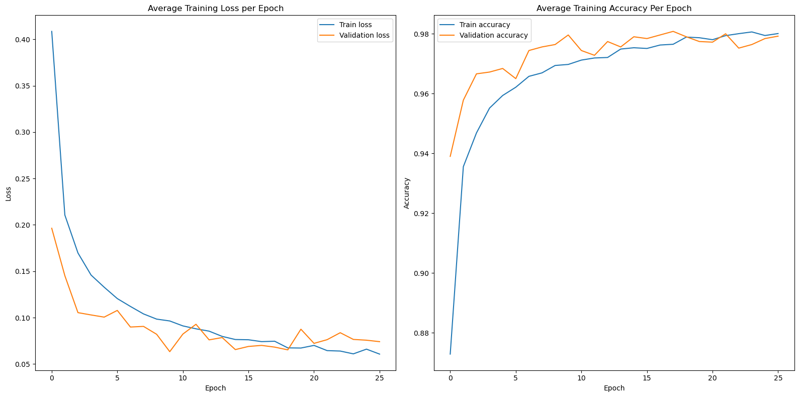
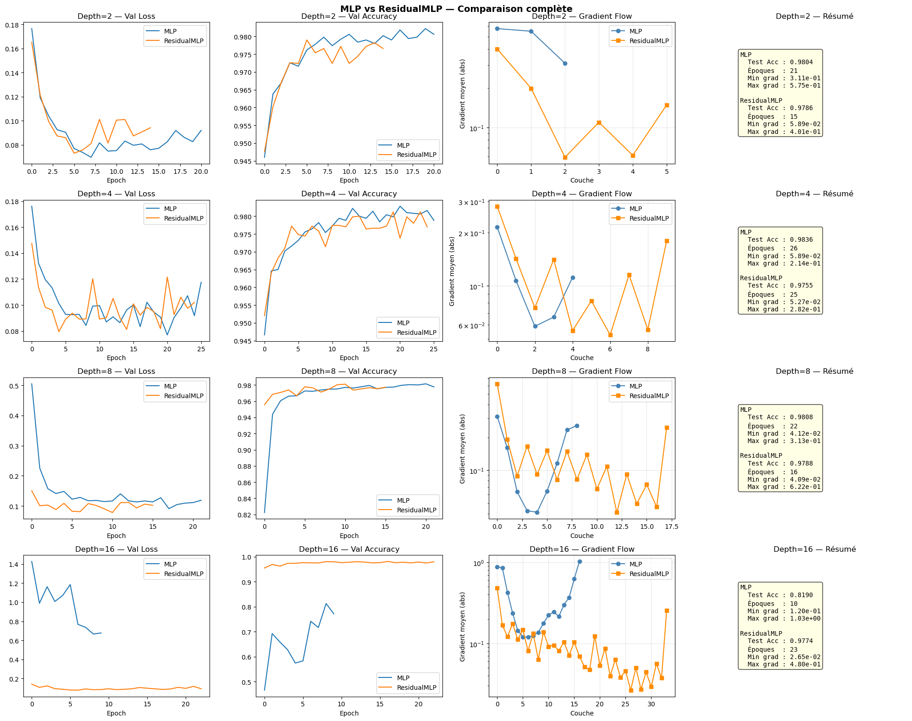
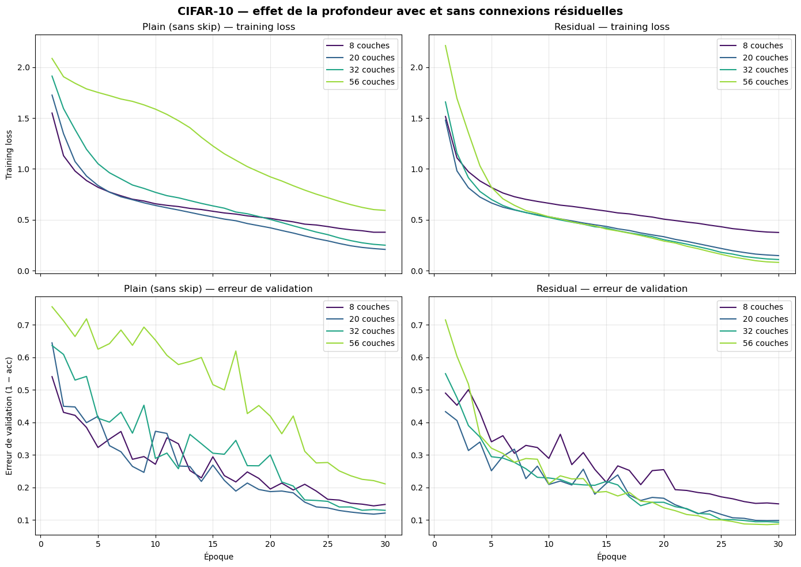
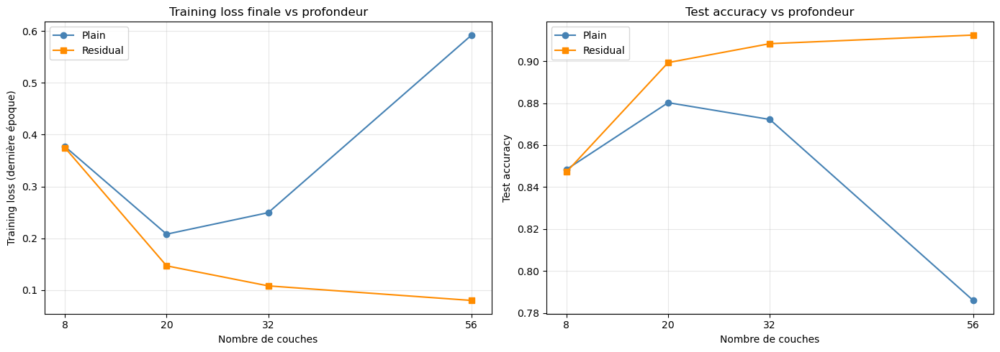
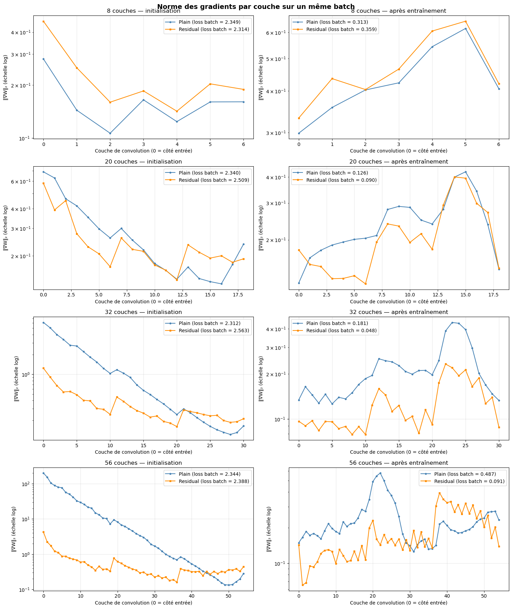
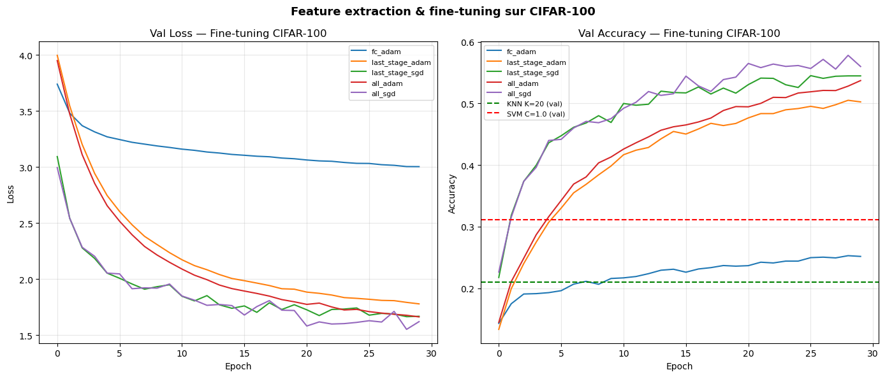
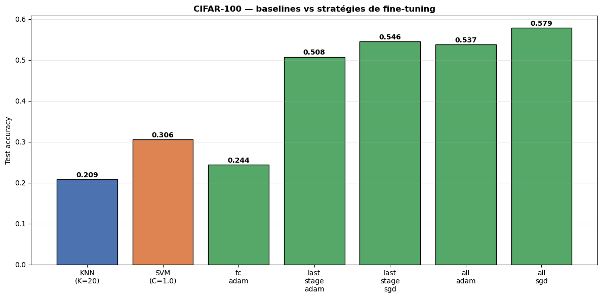

# Lab 1 — Réseaux résiduels : MLP, CNN et transfer learning

> 🇬🇧 An English version of this document is available in [README.md](README.md).

Ce dépôt contient ma solution du premier laboratoire du cours **Deep Learning Applications**. L'objectif du lab est de reproduire, à petite échelle, le résultat principal du papier ResNet :

> Kaiming He, Xiangyu Zhang, Shaoqing Ren, Jian Sun. [*Deep Residual Learning for Image Recognition*](https://arxiv.org/abs/1512.03385). CVPR 2016.

Le message central de ce papier est que **rendre un réseau plus profond ne garantit pas de meilleurs résultats**. Au-delà d'une certaine profondeur, les réseaux « plain » deviennent plus difficiles à optimiser, et même leur erreur *d'entraînement* augmente. Les **connexions résiduelles** (skip connections) résolvent ce problème. Dans ce lab, j'ai :

1. construit un pipeline d'entraînement et une MLP de référence sur MNIST ;
2. comparé des MLP avec et sans connexions résiduelles à des profondeurs croissantes ;
3. refait l'expérience avec des CNN sur CIFAR-10, avec une comparaison équitable plain vs résiduel de 8 à 56 couches, et analysé les gradients ;
4. réutilisé le meilleur CNN résiduel pour du **transfer learning** vers CIFAR-100 (extraction de features + fine-tuning).

---

## Sommaire

- [Structure du dépôt](#structure-du-dépôt)
- [Installation](#installation)
- [Rappels : réseaux plain, dégradation et connexions résiduelles](#rappels--réseaux-plain-dégradation-et-connexions-résiduelles)
- [Exercice 1.1 — MLP de référence et pipeline d'entraînement](#exercice-11--mlp-de-référence-et-pipeline-dentraînement)
- [Exercice 1.2 — MLP avec connexions résiduelles](#exercice-12--mlp-avec-connexions-résiduelles)
- [Exercice 1.3 — CNN plain vs résiduels sur CIFAR-10](#exercice-13--cnn-plain-vs-résiduels-sur-cifar-10)
- [Exercice 2.1 — Transfer learning vers CIFAR-100](#exercice-21--transfer-learning-vers-cifar-100)
- [Conclusion](#conclusion)

---

## Structure du dépôt

```
.
├── Lab-CNNs.ipynb          # Notebook avec tout le code, les expériences et les sorties
├── README.md               # Version anglaise
├── README_FR.md            # Ce fichier (français)
└── images/                 # Graphiques utilisés dans ce README
    ├── ex1_1_mlp_baseline.png
    ├── ex1_2_mlp_vs_resmlp.png
    ├── ex1_3_training_curves.png
    ├── ex1_3_results_vs_depth.png
    ├── ex1_3_gradients.png
    ├── ex2_1_finetuning_curves.png
    └── ex2_1_test_accuracy.png
```

| Section | Contenu |
|---|---|
| Exercice 1.1 | Pipeline d'entraînement générique (loss et accuracy train/val, early stopping, sauvegarde du meilleur modèle, suivi avec Weights & Biases) et MLP de référence sur MNIST |
| Exercice 1.2 | `ResidualMLP`, comparaison avec la MLP plain aux profondeurs 2, 4, 8 et 16, normes des gradients |
| Exercice 1.3 | `CifarNet` (CNN de type ResNet pour CIFAR-10) avec un flag `residual` ; 8 modèles (8, 20, 32, 56 couches × plain/résiduel) ; courbes d'entraînement ; analyse des gradients sur un même batch |
| Exercice 2.1 | ResNet-20 pré-entraîné sur CIFAR-10 utilisé sur CIFAR-100 : baselines KNN et SVM sur des features figées, puis 5 stratégies de fine-tuning |

Les exercices 2.2 (distillation de connaissances) et 2.3 (class activation maps) n'ont pas été traités (au moins un des trois était demandé).

## Installation

```bash
pip install torch torchvision numpy matplotlib scikit-learn tqdm wandb
```

Un GPU est fortement recommandé. L'entraînement des 8 CNN de l'exercice 1.3 prend environ une heure sur un GPU de milieu de gamme.

---

## Rappels : réseaux plain, dégradation et connexions résiduelles

Un **réseau plain** empile les couches les unes après les autres : chaque bloc calcule $y = F(x)$. Un **réseau résiduel** ajoute un *raccourci* qui saute le bloc : $y = F(x) + x$.

**Le problème de dégradation.** En théorie, un réseau plus profond ne devrait jamais faire moins bien qu'un réseau moins profond : les couches supplémentaires pourraient simplement apprendre l'identité et recopier leur entrée. En pratique, He et al. ont observé qu'un réseau plain à 56 couches a une **erreur d'entraînement plus élevée** qu'un réseau à 20 couches. Ce **n'est pas de l'overfitting**, puisque c'est l'erreur sur l'ensemble *d'entraînement* qui augmente. C'est un **problème d'optimisation** : la descente de gradient n'arrive pas à trouver de bons poids pour des réseaux plain très profonds.

**Pourquoi les connexions résiduelles aident.**
- Avec $y = F(x) + x$, « ne rien faire » devient facile : il suffit d'apprendre $F(x) \approx 0$.
- Pendant la rétropropagation, le gradient de chaque bloc contient un terme direct : $\frac{\partial L}{\partial x} = \frac{\partial L}{\partial y}\left(1 + \frac{\partial F}{\partial x}\right)$. Le signal d'erreur peut remonter de la sortie jusqu'aux premières couches par les raccourcis, sans être multiplié par chaque couche intermédiaire.

---

## Exercice 1.1 — MLP de référence et pipeline d'entraînement

### Objectif

Implémenter une MLP simple pour classifier les chiffres de MNIST, écrire mon **propre pipeline d'entraînement**, et entraîner le modèle jusqu'à convergence en suivant la loss et l'accuracy sur les ensembles d'entraînement et de validation à chaque époque.

### Méthode

**Données.** MNIST (60 000 images d'entraînement, 10 000 images de test, 28×28 en niveaux de gris), normalisées avec la moyenne et l'écart-type standards de MNIST. 5 000 images d'entraînement sont mises de côté pour la validation.

**Pipeline.** J'ai écrit des fonctions réutilisables, utilisées dans tout le lab :
- `train_one_epoch(...)` et `evaluate_model(...)` : retournent la loss moyenne et l'accuracy sur un data loader ;
- `train_model(...)` : boucle d'entraînement complète, qui enregistre la loss et l'accuracy train/val à chaque époque (aussi dans **Weights & Biases**), **sauvegarde le meilleur modèle** (plus petite loss de validation) et implémente un **early stopping** : l'entraînement s'arrête si la loss de validation augmente, ou ne s'améliore plus, pendant plusieurs époques ;
- `plot_validation_curves(...)` : courbes d'entraînement et de validation sur le même graphique.

**Modèle.** MLP 784 → 256 → 128 → 10, activations ReLU, dropout 0.2, Adam (lr = 1e-3), loss d'entropie croisée, jusqu'à 50 époques.

### Résultats

<!-- Graphique : loss et accuracy train/validation de la MLP de référence -->


| Métrique | Valeur |
|---|---|
| Époques (early stopping) | 19 |
| Loss de test | 0.0601 |
| **Accuracy de test** | **98,19 %** |

### Analyse

La MLP converge rapidement : l'accuracy de validation dépasse déjà 96 % après 2-3 époques. Ensuite, la loss d'entraînement continue de baisser alors que la loss de validation stagne et commence à osciller : c'est le début de l'overfitting. L'early stopping arrête l'entraînement à ce moment-là, et le meilleur checkpoint (plus petite loss de validation) est rechargé pour l'évaluation sur le test. Ce modèle, avec **98,19 %** d'accuracy en test, sert de référence pour les expériences suivantes.

---

## Exercice 1.2 — MLP avec connexions résiduelles

### Objectif

Implémenter une MLP composée de **blocs résiduels**, et la comparer à la MLP plain pour plusieurs profondeurs. Le but est de vérifier que les réseaux profonds *avec* connexions résiduelles sont plus faciles à entraîner que des réseaux de même profondeur *sans* ces connexions.

### Méthode

- **Bloc résiduel** : Linear → ReLU → Dropout → Linear, puis l'entrée du bloc est ajoutée à la sortie, suivie d'une ReLU : $y = \text{ReLU}(F(x) + x)$. L'entrée et la sortie ont la même taille pour pouvoir être additionnées.
- **ResidualMLP** : projection d'entrée 784 → 128, puis `depth` blocs résiduels de largeur 128, puis un classifieur linéaire 128 → 10.
- **MLP plain** : `depth` couches cachées dont la largeur diminue géométriquement de 512 à 32 (par exemple, profondeur 4 : 784 → 512 → 203 → 80 → 32 → 10).
- Profondeurs testées : **2, 4, 8 et 16** ; même optimiseur (Adam, lr = 1e-3), dropout 0.2, jusqu'à 30 époques avec early stopping.
- **Analyse des gradients** : norme L2 du gradient de chaque matrice de poids, lue après l'entraînement.

### Résultats

<!-- Graphique : loss et accuracy de validation, normes des gradients et résumé pour chaque profondeur -->


| Profondeur | MLP acc test | MLP époques | ResidualMLP acc test | ResidualMLP époques |
|---|---|---|---|---|
| 2 | 98,04 % | 21 | 97,86 % | 15 |
| 4 | 98,36 % | 26 | 97,55 % | 25 |
| 8 | 98,08 % | 22 | 97,88 % | 16 |
| 16 | **81,90 %** | 10 | **97,74 %** | 23 |

### Analyse

- **Jusqu'à 8 couches**, les deux architectures atteignent ~98 %. MNIST est un problème facile, et les réseaux peu profonds s'entraînent sans difficulté.
- **À 16 couches**, la MLP plain devient beaucoup plus difficile à optimiser. Son accuracy de validation démarre à ~47 %, oscille fortement, et l'accuracy de test finale tombe à **81,9 %**. La ResidualMLP de même profondeur atteint ~95 % dès la première époque et termine à **97,7 %**. C'est le comportement décrit dans le papier ResNet : la profondeur seule n'améliore pas les performances, et les connexions résiduelles rendent les réseaux profonds entraînables.
- **Gradients.** Dans la MLP plain à 16 couches, les normes de gradient sont fortes aux deux extrémités du réseau (≈ 0,9 pour la première couche, ≈ 1,0 pour la dernière) mais beaucoup plus faibles au milieu (≈ 0,12). Le signal d'apprentissage est très inégalement réparti entre les couches. Dans la ResidualMLP, les normes décroissent régulièrement d'un bloc à l'autre, sans rupture, car chaque raccourci offre un chemin direct au gradient.

**Limites de cette expérience** (corrigées à l'exercice 1.3) :
1. Les deux architectures ne sont pas strictement identiques : la MLP plain a des largeurs décroissantes (512 → 32), alors que la ResidualMLP a une largeur constante (128) et 2 couches linéaires par bloc.
2. La MLP plain à 16 couches a été arrêtée par l'early stopping après 10 époques, alors que son accuracy de validation augmentait encore, ce qui accentue l'écart.
3. Les gradients ont été lus après l'entraînement, sur le dernier batch, et pas sur un même batch au même moment pour les deux modèles.

---

## Exercice 1.3 — CNN plain vs résiduels sur CIFAR-10

### Objectif

Refaire la vérification avec des réseaux convolutifs sur CIFAR-10. Le but est de montrer que **des CNN plain plus profonds ne marchent pas toujours mieux**, alors que **des CNN résiduels encore plus profonds**, si.

### Méthode

**Données.** CIFAR-10 (50 000 images d'entraînement, 10 000 images de test, 32×32 en couleur, 10 classes). 5 000 images d'entraînement servent de validation. Les images d'entraînement sont augmentées (recadrage aléatoire avec un padding de 4 pixels + symétrie horizontale). **Les images de validation et de test ne sont pas augmentées** : le split de validation utilise une seconde copie du dataset avec la transformation d'évaluation.

**Architecture : `CifarNet(n, residual)`**, d'après la section 4.2 du papier ResNet :
- une convolution 3×3 à 16 canaux, puis **3 stages** de *n* blocs chacun, avec 16, 32 et 64 canaux, sur des cartes de 32×32, 16×16 et 8×8 ;
- la réduction de résolution se fait par une convolution de stride 2 dans le premier bloc des stages 2 et 3, sans max-pooling ;
- un global average pooling, puis une couche linéaire à 10 sorties ;
- chaque bloc contient 2 convolutions 3×3 avec BatchNorm, donc la profondeur totale est de **6n + 2** couches. J'ai testé *n* = 1, 3, 5, 9, soit **8, 20, 32 et 56 couches**.

**La seule différence entre plain et résiduel est le flag `residual` du bloc.** Les deux versions ont les mêmes couches, les mêmes largeurs et la même initialisation (même seed, initialisation de Kaiming). Quand la forme change entre l'entrée et la sortie d'un bloc, le raccourci est une convolution 1×1 avec BatchNorm (option B du papier). Cela n'ajoute que ~2 750 paramètres au modèle résiduel :

| Profondeur | Plain (params) | Résiduel (params) |
|---|---|---|
| 8 | 75 290 | 78 042 |
| 20 | 269 722 | 272 474 |
| 32 | 464 154 | 466 906 |
| 56 | 853 018 | 855 770 |

Le bloc est adapté du `BasicBlock` de torchvision, modifié pour pouvoir désactiver la skip connection.

**Entraînement.** Identique pour les 8 modèles : SGD avec momentum de Nesterov 0.9, lr initial 0.1, weight decay 5e-4, learning rate **cosine**, batch 128, **30 époques, sans early stopping**, pour comparer les loss d'entraînement à budget égal. Le checkpoint avec la meilleure accuracy de validation est utilisé pour l'évaluation sur le test.

**Analyse des gradients.** Pour chaque profondeur, je calcule la norme L2 du gradient de chaque convolution 3×3 sur **le même batch d'entraînement**, pour le modèle plain et le modèle résiduel, à deux moments : **à l'initialisation** (mêmes poids de départ) et **après l'entraînement** (meilleurs checkpoints).

### Résultats

<!-- Graphique : loss d'entraînement et erreur de validation par profondeur, plain (gauche) vs résiduel (droite) -->


<!-- Graphique : loss d'entraînement finale et accuracy de test en fonction de la profondeur -->


| Couches | Plain : train loss finale | Plain : acc test | Résiduel : train loss finale | Résiduel : acc test |
|---|---|---|---|---|
| 8 | 0,377 | 84,84 % | 0,375 | 84,72 % |
| 20 | **0,208** | **88,02 %** | 0,147 | 89,93 % |
| 32 | 0,250 | 87,22 % | 0,108 | 90,83 % |
| 56 | **0,592** | **78,60 %** | **0,080** | **91,24 %** |

<!-- Graphique : norme du gradient par couche de convolution sur un même batch, à l'initialisation et après l'entraînement -->


| Modèle | Rapport ‖∇W‖ première couche / dernière couche à l'initialisation |
|---|---|
| plain-8 / res-8 | 1,75 / 2,44 |
| plain-20 / res-20 | 2,9 / 3,05 |
| plain-32 / res-32 | 37,2 / 5,86 |
| plain-56 / res-56 | **701** / **9,6** |

### Analyse

- **Dégradation des réseaux plain.** Au-delà de 20 couches, la loss d'entraînement finale des CNN plain *augmente* avec la profondeur : 0,208 (20 couches) → 0,250 (32) → **0,592 (56)**. Le réseau plain à 56 couches a une loss d'entraînement presque trois fois plus élevée que celui à 20 couches, et sa courbe reste au-dessus de toutes les autres pendant tout l'entraînement. Comme c'est l'erreur *d'entraînement* qui est plus haute, ce n'est pas de l'overfitting mais un problème d'**optimisation**. On reproduit ainsi le résultat principal du papier ResNet (sa Figure 6).
- **Les réseaux résiduels profitent de la profondeur.** Avec exactement les mêmes couches, la loss d'entraînement diminue à chaque augmentation de profondeur (0,375 → 0,147 → 0,108 → 0,080) et l'accuracy de test augmente (84,7 → 89,9 → 90,8 → **91,2 %**). Le réseau résiduel à 56 couches est le meilleur modèle, alors que le réseau plain à 56 couches est le pire (**+12,6 points** en faveur de la version résiduelle).
- **À 8 couches**, les deux versions sont identiques (84,8 % contre 84,7 %) : le réseau est trop peu profond pour que les skip connections changent quelque chose.
- **Gradients.** À l'initialisation, le gradient de la première couche de plain-56 est environ **700 fois plus grand** que celui de sa dernière couche (≈ 200 contre ≈ 0,3), et ce rapport augmente vite avec la profondeur (1,75 → 2,9 → 37 → 701). Dans les réseaux plain profonds, les gradients **explosent** en remontant vers l'entrée : les premières couches reçoivent des mises à jour beaucoup trop grandes par rapport aux dernières, ce qui rend l'optimisation très difficile. Pour les réseaux résiduels, le rapport reste modéré (9,6 pour res-56), car chaque raccourci ajoute un terme direct au gradient. Comme le souligne le papier ResNet, avec la BatchNorm, le problème n'est pas simplement un gradient qui *s'annule*, mais une propagation mal conditionnée à travers de nombreuses couches successives. Après l'entraînement, les normes des gradients sont du même ordre de grandeur pour tous les modèles.

---

## Exercice 2.1 — Transfer learning vers CIFAR-100

### Objectif

Utiliser un CNN résiduel entraîné sur CIFAR-10 pour une nouvelle tâche, CIFAR-100 (100 classes) :
1. comme **extracteur de features**, avec un classifieur classique, pour établir une baseline stable ;
2. avec du **fine-tuning**, en testant plusieurs stratégies : dégeler différentes parties du réseau et utiliser différents optimiseurs.

### Méthode

**Modèle pré-entraîné :** le `CifarNet` résiduel à 20 couches (res-20) de l'exercice 1.3 (89,9 % d'accuracy de test sur CIFAR-10).

**Données.** CIFAR-100 (50 000 images d'entraînement, 10 000 images de test, 100 classes), normalisées avec les statistiques de CIFAR-100 ; 5 000 images d'entraînement pour la validation. Le split d'entraînement est augmenté pour le fine-tuning ; la validation, le test et l'extraction de features utilisent des images non augmentées.

**1. Extraction de features + classifieurs classiques.** Les activations de dimension 64 après le global average pooling (l'entrée du classifieur) sont extraites pour toutes les images, puis standardisées (`StandardScaler` ajusté sur le train). Deux classifieurs sont entraînés, avec des hyperparamètres choisis sur la validation :
- **KNN** (distance cosinus), K ∈ {1, 5, 10, 20, 50} ;
- **SVM linéaire**, C ∈ {0.001, 0.01, 0.1, 1, 10}.

**2. Fine-tuning.** Le classifieur à 10 classes est remplacé par une nouvelle couche linéaire à **100 classes**, initialisée aléatoirement, et les poids CIFAR-10 sont chargés pour tout le reste. Cinq configurations, 30 époques chacune :

| Configuration | Ce qui est entraîné | Optimiseur | lr | Params entraînés |
|---|---|---|---|---|
| `fc_adam` | uniquement la nouvelle tête | Adam | 1e-3 | 6 500 |
| `last_stage_adam` | dernier stage (64 canaux) + tête | Adam | 1e-4 | 212 196 |
| `last_stage_sgd` | dernier stage + tête | SGD (momentum 0.9) | 1e-2 | 212 196 |
| `all_adam` | tout le réseau | Adam | 1e-4 | 278 324 |
| `all_sgd` | tout le réseau | SGD (momentum 0.9) | 1e-2 | 278 324 |

**BatchNorm gelées.** Mettre `requires_grad = False` ne gèle pas les statistiques (moyenne et variance) des couches BatchNorm : elles continuent d'être mises à jour en mode `train()`. Pour vraiment geler une partie du réseau, les BatchNorm des blocs gelés sont maintenues en mode `eval()` pendant l'entraînement.

### Résultats

**Baselines sur les features figées**

| Classifieur | Meilleur hyperparamètre | Acc val | Acc test |
|---|---|---|---|
| KNN | K = 20 | 20,96 % | 20,87 % |
| SVM linéaire | C = 1.0 | 31,10 % | **30,63 %** |

**Fine-tuning**

<!-- Graphique : loss et accuracy de validation des 5 stratégies de fine-tuning, avec les baselines -->


<!-- Graphique : accuracy de test de toutes les méthodes -->


| Configuration | Params entraînés | Meilleure acc val | Acc test |
|---|---|---|---|
| `fc_adam` | 6 500 | 25,28 % | 24,41 % |
| `last_stage_adam` | 212 196 | 50,50 % | 50,78 % |
| `last_stage_sgd` | 212 196 | 54,50 % | 54,58 % |
| `all_adam` | 278 324 | 53,70 % | 53,75 % |
| **`all_sgd`** | 278 324 | **57,80 %** | **57,91 %** |

### Analyse

- **Des baselines faibles.** Les features figées ne donnent que 20,9 % (KNN) et 30,6 % (SVM) sur CIFAR-100. Les features de dimension 64 ont été apprises pour séparer 10 classes. Elles contiennent une information visuelle générale (bien au-dessus du hasard, à 1 %), mais elles ne sont pas assez riches pour distinguer 100 classes plus fines. Le SVM linéaire fait mieux que le KNN, qui souffre de distances calculées dans un espace qui n'a pas été conçu pour ces classes.
- **Le fine-tuning apporte un gain important.** Fine-tuner tout le réseau avec SGD atteint **57,9 %**, presque **le double** de la baseline SVM. Adapter les features convolutives aux nouvelles classes est essentiel.
- **Plus on dégèle de couches, meilleur c'est.** Entraîner seulement la tête (24,4 %) ne suffit clairement pas. C'est même en dessous du SVM : c'est aussi un classifieur linéaire sur les mêmes features figées, mais entraîné avec Adam, sans standardisation des features et sans réglage, alors que le C du SVM a été optimisé sur la validation. Dégeler le dernier stage (76 % des paramètres) donne déjà l'essentiel du gain (54,6 %). Tout dégeler ajoute encore environ 3 points.
- **SGD bat Adam dans les deux cas** (+3,8 points pour le dernier stage, +4,2 points pour tout le réseau). C'est cohérent avec la pratique courante pour les CNN de type ResNet, où SGD avec momentum généralise souvent mieux qu'Adam. Les learning rates n'ont cependant pas été réglés pour chaque optimiseur : une partie de l'écart peut venir du choix du lr (1e-2 pour SGD, 1e-4 pour Adam).
- Les courbes de la plupart des configurations montent encore après 30 époques : un entraînement plus long améliorerait probablement tous les résultats de fine-tuning.

---

## Conclusion

- **La profondeur seule ne garantit pas de meilleures performances.** Sur MNIST (exercice 1.2), la MLP plain à 16 couches tombe à 81,9 %, alors que la MLP résiduelle de même profondeur reste à 97,7 %. Sur CIFAR-10 (exercice 1.3), avec une comparaison strictement équitable, la loss d'entraînement des CNN plain augmente au-delà de 20 couches, et le réseau plain à 56 couches termine à 78,6 % d'accuracy de test. C'est le **problème de dégradation** du papier ResNet : un problème d'optimisation, et non de l'overfitting.
- **Les connexions résiduelles résolvent ce problème.** Avec les mêmes couches, les CNN résiduels s'améliorent à chaque augmentation de profondeur, jusqu'à **91,2 %** pour 56 couches. L'analyse des gradients montre pourquoi : dans les réseaux plain profonds, les gradients explosent vers l'entrée à l'initialisation (rapport de 701 entre la première et la dernière couche pour 56 couches), alors que les raccourcis gardent une propagation équilibrée (rapport de 9,6).
- **Les réseaux résiduels se transfèrent bien.** Un ResNet-20 entraîné sur CIFAR-10 peut être réutilisé sur CIFAR-100. Les features figées avec un SVM linéaire donnent une baseline de 30,6 %, et le fine-tuning atteint 57,9 %. Dégeler plus de couches et utiliser SGD ont donné les meilleurs résultats.
- **La méthodologie compte.** Plusieurs bugs ou biais de mes premières versions n'ont été trouvés qu'en vérifiant le protocole : des architectures non comparables, une validation augmentée, des gradients lus au mauvais moment, des BatchNorm qui n'étaient pas vraiment gelées. C'est une comparaison équitable (mêmes couches, même seed, même budget d'entraînement) qui a rendu le phénomène de dégradation clairement visible.

**Limites :** entraînement court (30 époques) et une seule seed par configuration ; les exercices 2.2 et 2.3 n'ont pas été traités.
