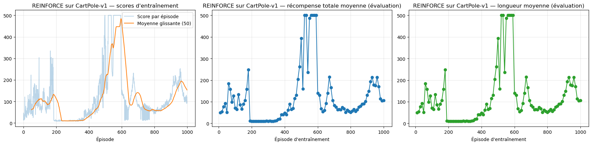
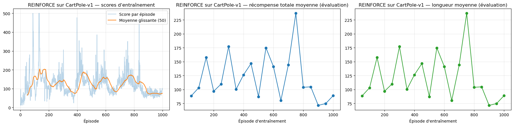
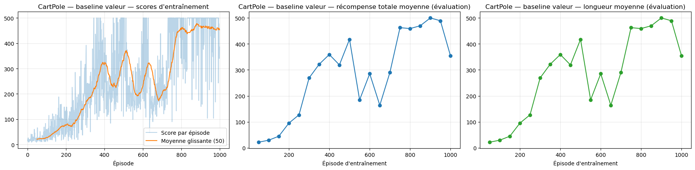
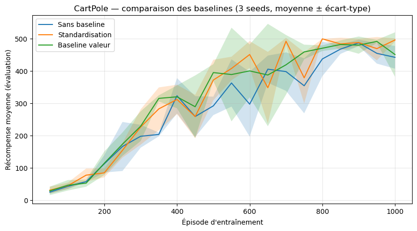
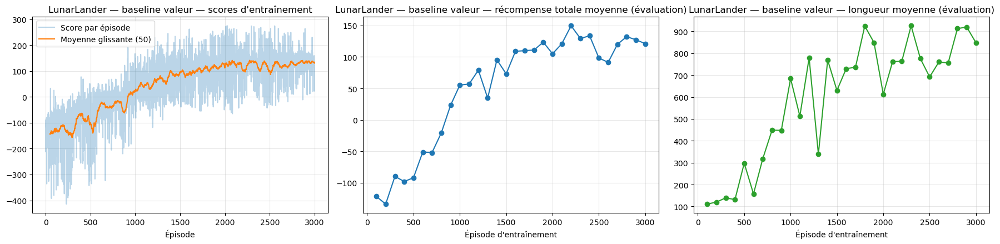

# Lab 2 — Deep Reinforcement Learning: REINFORCE, Baselines and Lunar Lander

> 🇫🇷 A French version of this document is available in [README_FR.md](README_FR.md).

This repository contains my solution to the second laboratory of the **Deep Learning Applications** course. The goal of the lab is to get policy-gradient Deep Reinforcement Learning algorithms working, measure how stable they are, and improve them. Starting from a basic implementation of **REINFORCE** on the CartPole environment, I:

1. improve how the agent's performance is evaluated during training;
2. add **baselines** (return standardization and a learned value network) to reduce the variance of the policy gradient, and compare them fairly over several random seeds;
3. apply the best version to a harder environment, **Lunar Lander**.

---

## Table of contents

- [Repository structure](#repository-structure)
- [Requirements](#requirements)
- [Background: REINFORCE and baselines](#background-reinforce-and-baselines)
- [Exercise 1 — Improving the evaluation of REINFORCE](#exercise-1--improving-the-evaluation-of-reinforce)
- [Exercise 2 — REINFORCE with a baseline](#exercise-2--reinforce-with-a-baseline)
- [Exercise 3.1 — Lunar Lander with REINFORCE](#exercise-31--lunar-lander-with-reinforce)
- [Conclusion](#conclusion)

---

## Repository structure

```
.
├── DLA-Lab2-DRL.ipynb      # Notebook with all the code, experiments and outputs
├── README.md               # This file (English)
├── README_FR.md            # French version
└── images/                 # Plots used in this README
    ├── ex1_reinforce_run1.png
    ├── ex1_reinforce_run2.png
    ├── ex2_value_baseline_single_run.png
    ├── ex2_baselines_comparison.png
    └── ex3_lunarlander.png
```

The notebook follows the order of the exercises:

| Section | Content |
|---|---|
| Exercise 1 | Exploration of CartPole, the provided REINFORCE implementation, new evaluation protocol (average reward and episode length every N episodes) |
| Exercise 2 | REINFORCE with the standardization baseline, then with a learned value-function baseline; fair comparison of the three variants over 3 seeds |
| Exercise 3.1 | REINFORCE with value baseline on LunarLander, with stochastic and greedy evaluation |

## Requirements

```bash
pip install torch numpy matplotlib "gymnasium[box2d]"
```

The notebook uses `CartPole-v1` and `LunarLander-v2`. In recent versions of Gymnasium (≥ 1.0), Lunar Lander is called `LunarLander-v3`.

---

## Background: REINFORCE and baselines

In policy-gradient methods, a neural network directly outputs a **policy** π(a | s, θ): a probability distribution over actions for each state. The goal is to maximize the expected return J(θ). **REINFORCE** is the simplest algorithm of this family:

1. play a complete episode with the current policy, storing states, actions and rewards;
2. compute, for every time step, the discounted return $G_t = \sum_{k \ge t} \gamma^{k-t} r_k$;
3. update the policy in the direction that makes good actions more likely:

$$\theta \leftarrow \theta + \alpha \sum_t G_t \, \nabla_\theta \log \pi(A_t \mid S_t, \theta)$$

In practice we minimize the loss $-\sum_t G_t \log \pi(A_t \mid S_t)$.

**The problem: variance.** $G_t$ is estimated from a single sampled episode, so it is very noisy. Two episodes with the same policy can give very different returns. The gradient therefore has very high variance, which makes learning slow and unstable.

**The solution: a baseline.** Any function $b(s)$ that does not depend on the action can be subtracted from $G_t$ without biasing the gradient:

$$\theta \leftarrow \theta + \alpha \sum_t \big(G_t - b(S_t)\big) \, \nabla_\theta \log \pi(A_t \mid S_t, \theta)$$

Intuitively, the agent no longer asks "was the return high?" but "was the return **higher than expected**?". Actions that did better than expected are reinforced, the others are discouraged. This greatly reduces the variance of the gradient. In this lab I compare two baselines:

- **Standardization** (constant per episode): $\frac{G_t - \bar G}{\sigma_G}$, where the mean and standard deviation are computed over the episode.
- **Value function** (depends on the state): $b(s) = \hat v(s \mid w)$, a second neural network trained to predict the expected return from state $s$.

---

## Exercise 1 — Improving the evaluation of REINFORCE

### Objective

Get REINFORCE working on CartPole and replace the original evaluation (a running average of training scores) with a more reliable protocol: every **N** training episodes, run the agent for **M** separate episodes and record (1) the **average total reward** and (2) the **average episode length**.

### Environment: CartPole-v1

A pole is attached to a cart that moves along a track. The agent must keep the pole upright.
- **Observation** (4 values): cart position, cart velocity, pole angle, pole angular velocity.
- **Actions** (2): push the cart left or right.
- **Reward**: +1 for every time step the pole stays upright. The episode ends when the pole falls or the cart leaves the track (`terminated`), or after **500 steps** (`truncated`). The maximum score is therefore 500.

I first explored the environment (`reset()`, `observation_space`, `action_space`, a few random `step()` calls) to understand the format of observations and the difference between `terminated` and `truncated`.

### Model and method

- **Policy network**: a small MLP, 4 → 128 (ReLU) → 2, followed by a softmax that gives the probability of each action. Actions are **sampled** from this distribution, which provides exploration.
- **Training**: the REINFORCE implementation provided with the lab (it already standardizes returns within each episode), Adam optimizer with lr = 0.01, γ = 0.99, 1000 episodes.
- **New evaluation**: `evaluate_policy(env, policy, M)` runs M episodes under `torch.no_grad()` and returns the average total reward and the average length. `reinforce(...)` calls it every `eval_interval` = N episodes and returns three lists: training scores, evaluation rewards and evaluation lengths.

**Why this evaluation is better.** The training score of a single episode is very noisy, and a running average mixes in old versions of the policy. Evaluating the *current* policy over M episodes gives a cleaner picture of its real performance at that moment.

### Results

<!-- Plot: first run of REINFORCE on CartPole (lr = 0.01, N = 10, M = 10) -->


<!-- Plot: second run with the same configuration (N = 50) -->


### Analysis

- On CartPole the reward is +1 per step, so **average reward and average episode length are identical** (the two right-hand plots are the same). The length metric only becomes informative in environments where rewards vary, such as Lunar Lander.
- The new metrics clearly reveal the **instability of REINFORCE** with a high learning rate:
  - **Run 1**: the agent reaches ~250, **collapses to ~10** between episodes 200 and 370, reaches the maximum of 500 around episode 550, collapses again, and ends around 100.
  - **Run 2**, with the same configuration: the performance oscillates between ~70 and ~240 and never stabilizes, ending at 89.
  - In an earlier execution of the same code, the agent ended at 500.
- With **a single run, the final result is essentially random**. With lr = 0.01 and a high-variance gradient estimator, a few bad updates are enough to destroy a good policy. Policy-gradient methods are on-policy: a bad policy collects bad data, which makes recovery slow.

These observations motivate the next two improvements: **reducing gradient variance with a baseline**, and **comparing methods over several seeds** instead of a single run.

---

## Exercise 2 — REINFORCE with a baseline

### Objective

Reduce the variance of REINFORCE by subtracting a baseline from the return, and compare three variants on CartPole: no baseline, the standardization baseline, and a learned value-function baseline.

### Models and method

All three variants are implemented in **one single function**, `reinforce(..., baseline="none" | "std" | "value")`. Everything else is identical (networks, optimizer, γ, number of episodes, evaluation), so the comparison is fair.

- **Policy network**: 4 → 128 (ReLU) → 2 + softmax (as in Exercise 1).
- **Value network** $\hat v(s \mid w)$: **the same architecture** as the policy, but with a single output: 4 → 128 (ReLU) → 1.
- **Two separate Adam optimizers** (lr = 1e-3 each). The value loss and the policy loss have very different scales, so summing them into one loss with one optimizer would let the value loss dominate.

How the target (the "advantage") is computed for each variant:

| Variant | Target used in the policy loss |
|---|---|
| `none` | raw return $G_t$ |
| `std` | $(G_t - \bar G) / \sigma_G$, computed within the episode |
| `value` | $A_t = G_t - \hat v(S_t)$, then normalized |

**Training the value network.** After each episode, $\hat v$ is updated with an MSE loss towards the **raw** discounted returns: $\mathcal{L}_v = \frac{1}{T}\sum_t (\hat v(S_t) - G_t)^2$.

> **Important implementation detail.** My first implementation trained the value network on returns that had *already been standardized* per episode. That is wrong: after standardization every episode has mean 0 and standard deviation 1, so the same state gets a different target depending on how long the episode lasted. The network could not learn $v(s)$ and ended up predicting ≈ 0, making the "value baseline" almost identical to plain standardization. The corrected version fits $\hat v$ on raw returns and normalizes only the advantage $G_t - \hat v(S_t)$.

The baseline value is **detached** from the computational graph (`values.detach()`) when computing the advantage, so the policy gradient does not flow into the value network.

### Results

**Single run with the value baseline** (1000 episodes, evaluation every 50 episodes over 10 episodes):

<!-- Plot: REINFORCE with value baseline, single run -->


The agent learns steadily up to ~400, goes through two drops (around episodes 550 and 650), then reaches 460-500 from episode 750 onwards. The moving average of training scores stays around 450-470 at the end.

**Fair comparison of the three variants** (3 seeds: 0, 1, 2; 1000 episodes; lr = 1e-3; evaluation every 50 episodes over 10 episodes; curves show mean ± standard deviation across seeds):

<!-- Plot: comparison of the three baselines over 3 seeds -->


| Method | Final evaluation reward (mean ± std over 3 seeds) |
|---|---|
| No baseline | 442.8 ± 35.2 |
| Standardization | **496.5 ± 4.9** |
| Value baseline $\hat v(s)$ | 451.3 ± 68.9 |

### Analysis

- **All three variants solve CartPole** (≥ 440 on average after 1000 episodes). With lr = 1e-3, even the version without a baseline learns, which confirms that the learning rate of 0.01 used in Exercise 1 was a major cause of the collapses observed there.
- **Baselines speed up learning.** Between episodes 450 and 800, both variants with a baseline are clearly above the version without one. Around episode 600, the version without a baseline is around 300, against ~400-450 with a baseline. This is the expected effect: subtracting a baseline reduces the variance of the gradient without biasing it.
- **Standardization gives the best and most stable final result** (496.5 ± 4.9).
- **The value baseline is not better than standardization here.** Several reasons explain this:
  1. with only 3 seeds, the standard-deviation bands overlap widely, so the differences are **not statistically significant**;
  2. CartPole is a simple environment with a reward that is constant at every step, so a per-episode constant baseline already captures most of what a state-dependent baseline could bring;
  3. in my implementation the advantage $G_t - \hat v(S_t)$ is also normalized, which brings the two methods closer together;
  4. the value network starts from random weights and must itself learn while the policy changes, so its estimates are poor at the beginning of training.
- A state-dependent baseline is expected to bring more on environments where the value of a state varies a lot, such as Lunar Lander, which is why I use it in Exercise 3.1.

---

## Exercise 3.1 — Lunar Lander with REINFORCE

### Objective

Apply REINFORCE to a harder environment, **LunarLander**, and analyze the agent's performance with the same metrics as before.

### Environment: LunarLander-v2

The agent controls a lander and must land it softly on a landing pad between two flags.
- **Observation** (8 values): position (x, y), velocities, angle, angular velocity, and two booleans indicating whether each leg touches the ground.
- **Actions** (4): do nothing, fire the left engine, fire the main engine, fire the right engine.
- **Reward**: shaped reward. The agent gains points when it moves closer to the pad and slows down, +10 for each leg in contact with the ground, **+100 for landing** and **−100 for crashing**. Firing the engines costs a little at every step (fuel). The episode ends after a landing, a crash, or **1000 steps**.
- The environment is considered **solved** at an average score of **200**.

### Model and method

I reused the REINFORCE + **value baseline** implementation from Exercise 2, unchanged except for the input/output dimensions (8 → 128 → 4 for the policy, 8 → 128 → 1 for the value network):
- 3000 training episodes, γ = 0.99, lr = 1e-3 for both networks;
- evaluation every 100 episodes over 10 episodes (average reward and average length);
- **final evaluation** over 50 episodes, with two policies:
  - **stochastic**: actions sampled from π, as during training;
  - **greedy**: always the most likely action (argmax).

I chose the value baseline because, unlike CartPole, Lunar Lander states have very different values (an agent close to the pad is worth much more than one tilted at high altitude). A state-dependent baseline is therefore well suited.

### Results

<!-- Plot: LunarLander — training scores, evaluation reward and evaluation length -->


| Episode | Average eval reward | Average eval length |
|---|---|---|
| 100 | −121.9 | 110.8 |
| 800 | −20.8 | 448.7 |
| 2000 | 105.1 | 612.7 |
| 2200 | **149.6** (best) | 763.6 |
| 3000 | 121.2 | 847.8 |

**Final evaluation (50 episodes):**

| Policy | Average reward | Average length |
|---|---|---|
| Stochastic | **138.3** | 1000.0 |
| Greedy (argmax) | 81.9 | 996.1 |

### Analysis

- **The agent learns clearly.** The evaluation reward goes from about −130 (frequent crashes) to 120-150, and the moving average of training scores rises from −150 to ~130. Most of the progress happens between episodes 500 and 1600, followed by a plateau.
- **The environment is not solved** (threshold 200). The performance plateaus around 120-150 from episode ~1600 onwards.
- **The episode length explains why.** Lengths go from ~110 steps (the lander crashes quickly) to 850-1000 steps, and in the final stochastic evaluation **every episode lasts exactly 1000 steps**, the time limit. The agent has learned to **hover**: it avoids the −100 crash penalty and collects the shaping reward for staying close to the pad, but it never lands and never switches off its engines. It therefore never receives the +100 landing bonus, and it keeps paying the fuel cost. This is a classic **local optimum** of REINFORCE on Lunar Lander. Hovering is a "safe" strategy that is easy to find, and learning to land requires exploring risky behavior near the ground, where a mistake is heavily penalized.
- **The greedy policy is worse than the stochastic one** (81.9 vs 138.3). The learned policy is not "sharp" enough to be used deterministically: always taking the most likely action leads to repetitive trajectories, while the randomness of the stochastic policy helps it correct its course. This also shows that REINFORCE learned a policy that relies on its own noise.

**Possible improvements:** train for more episodes; add an **entropy bonus** to keep exploring; tune γ and the learning rate; update on batches of several episodes to reduce variance further; or use an off-policy method with a replay buffer, such as **Deep Q-Learning** (Exercise 3.2), which reuses past experience and is generally more sample-efficient.

---

## Conclusion

This lab showed in practice why Deep Reinforcement Learning is considered **hard to train stably**:

- **Evaluation matters.** Evaluating the current policy every N episodes over M episodes (Exercise 1) revealed that REINFORCE with a high learning rate can reach the maximum score and then collapse completely. A single run is not enough to draw conclusions, and results must be compared **over several seeds**.
- **Baselines reduce variance.** Subtracting a baseline from the return (Exercise 2) makes learning faster and more stable on CartPole. Standardization gave the best and most stable result, and the learned value baseline was comparable. On such a simple environment, the difference between the two is not significant over 3 seeds. Implementation details matter a lot: the value network must be trained on **raw** returns, with its own optimizer, and its output must be **detached** when computing the advantage.
- **REINFORCE has limits on harder tasks.** On Lunar Lander (Exercise 3.1), REINFORCE with a value baseline learned a reasonable policy (≈ 140 average reward), but got stuck in a **hovering** local optimum and did not reach the "solved" threshold of 200. Analyzing the **episode length**, and not only the reward, was essential to understand this behavior.

Overall, REINFORCE is simple and works on easy problems. But its high variance and its on-policy nature make it sensitive to hyperparameters and prone to local optima. This motivates more advanced methods: actor-critic methods, PPO, or off-policy algorithms with a replay buffer and a target network such as DQN.
